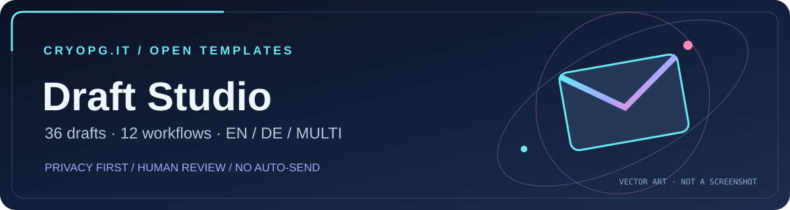
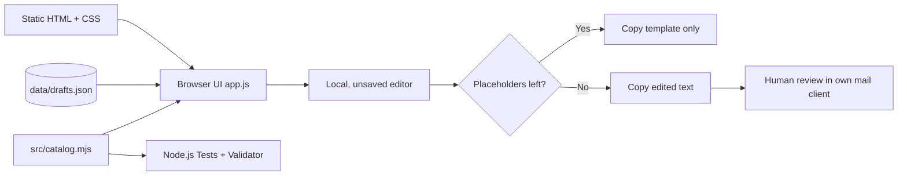

<div align="center">



# ✧ Draft Studio · e-mail-drafts-free

**36 anonymisierte E-Mail-Vorlagen · 12 Themen · Deutsch / English / Bilingual**

[App (Quellcode)](./index.html) · [Vorlagenkatalog](./drafts/INDEX.md) · [Datenschutzgrenzen](./docs/ANONYMIZATION.md) · [Qualitätsnachweise](./docs/QUALITY.md) · [Roadmap](./docs/ROADMAP.md)


</div>

> **Status: Entwicklung im Feature-Branch.** Die Funktionen sind im Quellcode implementiert; ein erfolgreicher CI-Lauf, Browserabnahme und echte Screenshots müssen separat nachgewiesen werden. Dieses Repository ist **kein** E-Mail-Dienst, keine KI-Integration und keine rechtsverbindliche Beratung.

## ✦ Was du bekommst / What you get

| Funktion / Feature | Aktueller Umfang / Current scope |
| --- | --- |
| Katalog / Catalog | 12 Anwendungsfälle × EN, DE, zweisprachig = **36 Vorlagen** |
| Finden / Discover | Suche in Betreff, Nachricht, Kategorie; Sprache, Thema, Ton filtern |
| Bearbeiten / Edit | Betreff und Nachricht im Browser bearbeiten; Änderungen nicht persistent |
| Sicherheit / Safety | Ausstehende Platzhalter anzeigen; bearbeitete Texte ohne Platzhalter kopieren |
| Kontrolle / Control | Unveränderte Vorlage separat kopieren; **niemals automatisch senden** |
| Daten / Data | Keine Anmeldung, API-Schlüssel, Mailbox-Anbindung oder serverseitige Eingabespeicherung |

Die Vorlagen sind Beispiele. **Namen, Beträge, Fristen, Empfänger und rechtliche Aussagen selbst prüfen.** Die Platzhalterprüfung erkennt lediglich `[TOKEN]`-Muster und leere Felder.

## ◇ Schnellstart / Quick start

**Voraussetzung / Requirement:** Python 3 oder ein beliebiger lokaler HTTP-Server; für Tests Node.js ≥ 20.

```bash
git clone https://github.com/Pierreg99/e-mail-drafts-free.git
cd e-mail-drafts-free
python3 -m http.server 8000
```

Öffne `http://localhost:8000` im Browser. **Nicht** einfach die Datei `index.html` per `file://` öffnen: Einige Browser blockieren dabei das Laden des JSON-Katalogs.

**Tests / Quality gates:**

```bash
npm run check
```

Das führt Katalogprüfung, Design-/Linkprüfung und Node.js-Tests aus – ohne Runtime-Abhängigkeiten. Die Browserabnahme bleibt ein eigener Nachweisschritt.

**GitHub Pages:** Optional kann nach dem Review unter *Settings → Pages* die Veröffentlichung aus dem Branch `main` mit Ordner `/ (root)` eingeschaltet werden. Diese Konfiguration wird nicht durch das Repository automatisch aktiviert.

## ✧ Bedienung / How to use

1. **Vorlage suchen:** Sprache (DE / EN / MULTI), Thema und Ton auswählen.
2. **Entwurf bearbeiten:** Betreff und Nachricht prüfen und anpassen.
3. **Platzhalter kontrollieren:** Alle `[NAME]`, `[DATE]`, `[END DATE]` usw. entfernen bzw. ersetzen.
4. **Kopieren:** `Text ohne Platzhalter kopieren` ist erst nach der technischen Platzhalterprüfung aktiv; `Vorlage kopieren` kopiert bewusst das anonymisierte Original.
5. **Extern prüfen und senden:** Inhalt, Adressat und Anhänge im eigenen Mailprogramm prüfen. Die Website hat **keine Senden-Funktion**.

**English:** Filter a template, edit subject and body, replace every placeholder, then copy it into your own mail client. Never treat placeholder validation as factual or legal verification.

## ◇ Architektur / Architecture



**Architekturgrenze:** Kein Backend, keine OpenAI-/Gmail-API, keine Schlüssel-Eingabe. Vertrauliche Werte nach Möglichkeit erst im privaten Mailprogramm ergänzen. Das Abrufen der Website/Assets wird vom jeweiligen Webhost wie üblich technisch verarbeitet; eingegebener Nachrichtentext wird durch den Anwendungscode nicht übermittelt.

## ✦ Repository-Navigation

| Pfad | Zweck |
| --- | --- |
| [`index.html`](./index.html), [`styles.css`](./styles.css), [`app.js`](./app.js) | Responsive Oberfläche, Interaktion, Kopierkontrolle |
| [`src/catalog.mjs`](./src/catalog.mjs) | Reine Filter-, Token- und Schemafunktionen |
| [`data/drafts.json`](./data/drafts.json) | Kanonischer Katalog mit 36 Entwürfen |
| [`drafts/INDEX.md`](./drafts/INDEX.md) | Bestehende Markdown-/PDF-Exporte |
| [`test/catalog.test.mjs`](./test/catalog.test.mjs) | Automatisierte Node.js-Tests |
| [`scripts/validate-catalog.mjs`](./scripts/validate-catalog.mjs) | Datenkonsistenz |
| [`scripts/check-design.mjs`](./scripts/check-design.mjs) | Statische UI-/Linkkonventionen |
| [`docs/QUALITY.md`](./docs/QUALITY.md) | Evidence-Matrix und Release-Gates |
| [`docs/ROADMAP.md`](./docs/ROADMAP.md) | Umsetzungs- und Prüfplan |
| [`docs/SCREENSHOTS.md`](./docs/SCREENSHOTS.md) | Anleitung für echte Browser-Screenshots |
| [`docs/ANONYMIZATION.md`](./docs/ANONYMIZATION.md) | Datenschutz-/Anonymisierungsregeln |
| [`docs/COACHING.md`](./docs/COACHING.md) | Vorlagenwahl und Qualitätshinweise |
| [`CONTRIBUTING.md`](./CONTRIBUTING.md) | Branch → PR → Review → Merge |

## ◇ Git-Begriffe / Git glossary

| Begriff | Deutsch | English |
| --- | --- | --- |
| **README** | Projekt-Einstieg und Dokumentation | Project introduction and documentation |
| **Commit** | Versionierter Änderungspunkt | Recorded change snapshot |
| **Push** | Lokale Commits zum Remote hochladen | Upload local commits to a remote |
| **Pull** | Remote-Änderungen holen und integrieren | Fetch and integrate remote changes |
| **Branch** | Separater Entwicklungszweig | Independent line of development |
| **PR / Pull Request** | Änderungsvorschlag mit Review und CI | Change proposal with review and checks |
| **Draft PR** | Noch nicht zur Freigabe bereit | Pull request not ready for review |
| **Squash** | Mehrere Commits zu einem zusammenfassen | Combine multiple commits into one |
| **CI** | Automatisierte Prüfungen bei Änderungen | Automated checks on changes |

## ✧ Nachweise statt Marketingbehauptungen

Eine Datei ist ein **Implementierungsnachweis**, kein bestandener Browsertest. Screenshots werden erst nach einem tatsächlichen Desktop-/Mobiltest eingebunden. **Keine simulierten Screenshots, keine erfundenen Coverage-/Sicherheits-Scores.** Siehe [Qualität](./docs/QUALITY.md) und [Screenshot-Prozess](./docs/SCREENSHOTS.md).

**Lizenz:** Bitte vor Weitergabe oder kommerzieller Nachnutzung den Lizenzstatus im Repository prüfen; diese README behauptet keine Open-Source-Lizenz, solange keine gültige `LICENSE`-Datei verifiziert wurde.

<details>
<summary>Bestands- und Migrationshinweis / Legacy compatibility</summary>

Die 36 vorhandenen Texte sowie die Markdown-/PDF-Exporte bleiben erhalten. Korrigiert wurden zehn überzählige Einträge in den `tokens`-Metadaten des JSON-Katalogs; die ursprünglichen Nachrichtentexte wurden dabei nicht verändert. Legacy-Exporte benötigen vor einem Release einen eigenen vollständigen Konsistenzabgleich.

</details>

<div align="center"><sub>CryoPG Design Workflow · Discover → Plan → Implement → Verify → Review · Dark Navy / Ice Cyan / Periwinkle / Neon Rosé</sub></div>
